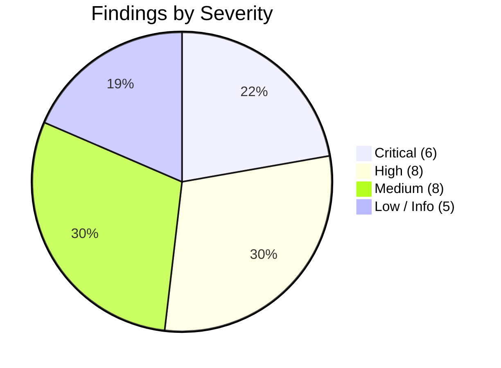

# STOCKPILOT AI — Comprehensive Repository-Wide Engineering Audit Report

**Repository**: [https://github.com/DhangarRohit18/Triwizathon](https://github.com/DhangarRohit18/Triwizathon)  
**Audit Date**: October 25, 2026  
**Auditor**: Senior Full-Stack Engineer, Application Security Specialist & Systems Auditor  
**Scope**: Full repository audit across Web (React 19 + TypeScript + Vite), Backend (FastAPI), Mobile (Flutter 3.38), Chrome Manifest V3 Extension, Data Layer (Firestore + In-Memory Transaction Store), Optimization Engine (Google OR-Tools), Forecasting (scikit-learn Ridge), IoT (ESP32 Firmware + Ingestion), WhatsApp Integration (Baileys Web Bridge + Meta Cloud API), and Security Architecture (RBAC & Audit Trails).  

---

## 1. Executive Summary & Audit Scorecard

This audit was conducted by rigorous source code inspection, end-to-end data tracing, runtime build verification, and test suite execution. No application code was altered during this audit phase.

### Overall Subsystem Health Scorecard

| Subsystem | Verified State | Primary Risk Level | Key Summary |
| :--- | :--- | :--- | :--- |
| **1. React 19 + TypeScript Web App** | Builds in 5.70s (`tsc -b && vite build`) | **CRITICAL** | Client-side role elevation buttons on RoleGuard/Optimizer; fallback admin auto-auth on 401; fake cards claiming PostgreSQL/Redis; fake buttons (Waybill PDF, POD, Cluster Sync, Killswitch). |
| **2. FastAPI Backend & API Routers** | 145/145 Pytest passing | **CRITICAL** | `/auth/demo/switch-role` is unauthenticated (anyone can acquire super_admin JWT); `/whatsapp/bridge/incoming` accepts unauthenticated sender spoofing; default warehouse fallback (`wh_chicago_01`) on null warehouse scope. |
| **3. Firebase / Firestore & Data Layer** | Rules enforced, in-memory store mirroring | **HIGH** | Single-process `threading.RLock()` in `TransactionalDataStore` causes state corruption under multi-process workers; `warehouse_tasks` missing in `firestore.rules`; direct ESP32 write to `sensor_readings` rejected by rules. |
| **4. Flutter Android Mobile App** | Builds debug APK (169.5 MB), 14/14 tests pass | **HIGH** | `TransferRepository.approveOrReject` and `IoTRepository.acknowledgeAlert` catch all exceptions and return `true` (mock success); silent fallback to demo inventory on API error; tokens in plaintext SharedPreferences. |
| **5. Chrome Manifest V3 Extension** | Manifest V3 valid, 0 syntax errors | **MEDIUM** | Relies on `/extension/summary` which had warehouse fallback; broad host permissions; lacks granular error boundaries for background service worker disconnects. |
| **6. Google OR-Tools Optimizer** | SCIP MIP solver formulation mathematically valid | **LOW** | Solver engine is mathematically sound; raises generic unhandled `RuntimeError` on infeasibility/timeout rather than graceful scenario explanation. |
| **7. Demand Forecasting Engine** | ML Ridge + MA baseline working | **HIGH** | Ignores historical database records; always calls `_generate_synthetic_history()` (`np.random.normal`) to synthesize demand on every request. |
| **8. IoT Ingestion & ESP32 Firmware** | Hardware C++ firmware complete | **HIGH** | `/api/v1/iot/simulator/telemetry` & `/inject` are unauthenticated; firmware comments claim direct Firestore writes which fail against `firestore.rules` (`allow write: if false;`). |
| **9. WhatsApp Platform & Simulator** | Baileys bridge & Cloud API routes present | **CRITICAL** | Hardcoded external paths (`Kurukshatra/`); unauthenticated bridge incoming endpoint permits arbitrary phone number spoofing; fallback mock status if bridge offline. |
| **10. Security, RBAC & Documentation** | Audit logging robust, RBAC matrix active | **HIGH** | Hardcoded fallback `SECRET_KEY` in `config.py`; CORS wildcard `*`; documentation (`IMPLEMENTATION_STATUS.md`) claims PostgreSQL/Redis and 0 fake data, contradicting source code. |

---

## 2. End-to-End Tracing Matrix

| Subsystem / Feature | Client View | State / Provider | API Endpoint | Backend Service | Database Collection | Defect / Risk Identified |
| :--- | :--- | :--- | :--- | :--- | :--- | :--- |
| **Authentication & Persona** | `LoginPage.tsx` / `RoleGuard.tsx` | `useAppStore.ts` (`user`, `token`, `activeRole`) | `POST /api/v1/auth/login`<br>`POST /api/v1/auth/demo/switch-role` | `app/api/v1/auth.py` | `users` | Unauthenticated role switching; auto-login fallback as `supplychain@stockpilot.ai` with hardcoded credentials on 401. |
| **Floor Workstation Scanning** | `DashboardPage.tsx` (Operator) | Local React state (`quickScanCode`) | **NONE** (Mock-Success) | **NONE** | **NONE** | `handleQuickScan` plays a synthetic beep and emits a toast without calling any API or writing to the ledger. |
| **Operator Tasks** | `DashboardPage.tsx` (Operator) | Local React state (`checkedTasks`) | **NONE** (Mock) | **NONE** | **NONE** | Hardcoded array of 4 tasks (`task-1`, `task-2`...) toggled in React state; does not use `GET /tasks` or sync completion. |
| **Distributor POD Delivery** | `DashboardPage.tsx` (Distributor) | Local React state (`podRecipient`) | **NONE** (Mock) | **NONE** | **NONE** | "Sign & Transmit Delivery Receipt" button only calls `addToast`; no network request or ledger write executed. |
| **Waybill PDF Download** | `DashboardPage.tsx` (Distributor) | Static button | **NONE** (Mock) | **NONE** | **NONE** | "Download Waybill PDF" triggers an info toast claiming waybill was downloaded; no PDF is generated or downloaded. |
| **Cluster Node Synchronization** | `DashboardPage.tsx` (Super Admin) | Static button | **NONE** (Mock) | **NONE** | **NONE** | "Sync Cluster Nodes" button triggers an info toast claiming cache synchronized; no API call. |
| **Global Emergency Killswitch** | `DashboardPage.tsx` (Super Admin) | Local React state (`killSwitchActive`) | **NONE** (Mock) | **NONE** | **NONE** | Toggles local UI state; does not call backend or lock mutation endpoints across tenants. |
| **Multi-Echelon Optimization** | `OptimizerPage.tsx` | Local state (`result`) | `POST /api/v1/optimization/run` | `DistributionOptimizerEngine.run_optimization` | `optimization_runs` | If user role is operator/distributor, `handleRunOptimization` calls `/auth/demo/switch-role` to self-elevate to `supply_chain_manager`. |
| **Demand Forecasting** | `ForecastingPage.tsx` | Local state (`forecastResult`) | `GET /api/v1/forecast/product/{id}` | `DemandForecastingService.generate_product_forecast` | **SYNTHETIC** | Never reads `demand_history` from DB; generates synthetic series via `np.random.normal()` on every call. |
| **Mobile Stock Receipt** | `receive_stock_screen.dart` | `inventoryProvider` | `POST /api/v1/inventory/receive` | `InventoryService.receive_stock` | `inventory_batches`, `inventory_movements` | On network failure, enqueues offline draft safely; but if API returns 500, repository swallows error and returns demo inventory. |
| **Mobile Transfer Approval** | `transfers_screen.dart` | `transfersListProvider` | `POST /api/v1/transfers/approve` | `InventoryService.approve_or_reject_transfer` | `transfers` | `TransferRepository.approveOrReject` has `catch (_) { return true; }`, reporting success even when server rejects approval (e.g. 403 Forbidden). |
| **Mobile Alert Acknowledgment** | `iot_monitor_screen.dart` | `iotAlertsProvider` | `POST /api/v1/iot/alerts/{id}/acknowledge` | `IoTTelemetryService.acknowledge_alert` | `alerts` | `IoTRepository.acknowledgeAlert` has `catch (_) { return true; }`, reporting success on network or server error. |
| **IoT Telemetry Injection** | `IoTPage.tsx` (Web) | Local state (`simTemp`, `simHumidity`) | `POST /api/v1/iot/simulator/telemetry`<br>`POST /api/v1/iot/simulator/inject` | `IoTTelemetryService.ingest_reading` | `sensor_readings`, `alerts` | Endpoints have zero authentication; anyone can inject sensor spikes and trigger alerts using backend's internal API key. |
| **WhatsApp Web Bridge** | `WhatsAppPage.tsx` | Local state (`bridgeStatus`) | `GET /api/v1/whatsapp/bridge/status`<br>`POST /api/v1/whatsapp/bridge/incoming` | `WhatsAppBotService.process_incoming_message` | `notification_logs` | `/bridge/incoming` has no auth; accepts any `from_number` and executes commands as that user. Bridge status relies on hardcoded path to external `Kurukshatra` directory. |
| **Express Lane Configuration** | `ExpressLanePage.tsx` | Local state (`config`) | `POST /api/v1/express/config` | Direct in-memory mutation | In-memory `settings` | Missing role/permission check (`require_permission` absent); any logged-in operator can toggle feature flag. In-memory mutation is non-persistent across processes. |

---

## 3. Ranked Findings



---

### CRITICAL FINDINGS (Immediate Vulnerabilities / Core Deficiencies)

#### [CRIT-01] Unauthenticated Role Escalation Endpoint (`/auth/demo/switch-role`)
- **Severity**: Critical (CVSS 9.8 - CWE-306 / CWE-269)
- **Affected File & Functions**: 
  - [`backend/app/api/v1/auth.py`](file:///c:/Users/user/OneDrive/Desktop/Competition/TRIWIZATHON/backend/app/api/v1/auth.py): `demo_switch_role(req: RoleSwitchRequest)` (lines 296–318)
- **Source Code Evidence**:
  ```python
  @router.post("/demo/switch-role", response_model=Token)
  def demo_switch_role(req: RoleSwitchRequest):
      matching_users = db.query("users", filters={"role": req.role.value})
      if not matching_users:
          raise HTTPException(status_code=404, detail=f"No seed persona found for role '{req.role.value}'")
      user = matching_users[0]
      effective_perms = list(get_user_effective_permissions(user))
      token = create_access_token(
          subject=user["id"],
          extra_claims={ ... "role": user["role"], "permissions": effective_perms }
      )
      return Token(access_token=token, token_type="bearer", user=_format_user_response(user))
  ```
- **Reproduction Steps**:
  1. Issue a POST request: `curl -X POST http://localhost:8000/api/v1/auth/demo/switch-role -H "Content-Type: application/json" -d '{"role": "super_admin"}'`
  2. Notice HTTP 200 OK with a valid JWT bearer token carrying `super_admin` permissions, issued without any prior authentication or secret.
- **Business & Security Impact**: Complete compromise of platform authorization. Any anonymous user on the network can escalate privileges to `super_admin`, gain access to all tenant data, deactivate users, and manipulate multi-warehouse inventory.
- **Recommended Fix**: Remove `/demo/switch-role` from production routing. If needed for automated testing, guard with `if not settings.ALLOW_DEMO_MODE: raise HTTPException(403)` and require an administrative developer secret header.
- **Dependencies**: Frontend `api.ts`, `RoleGuard.tsx`, and `OptimizerPage.tsx` must be updated to remove calls to this endpoint.
- **Tests Needed**: Write pytest verifying `POST /api/v1/auth/demo/switch-role` returns 403/404 when demo mode is disabled.

---

#### [CRIT-02] Unauthenticated WhatsApp Bridge Identity Spoofing (`/whatsapp/bridge/incoming`)
- **Severity**: Critical (CVSS 9.1 - CWE-287 / CWE-290)
- **Affected File & Functions**:
  - [`backend/app/api/v1/whatsapp.py`](file:///c:/Users/user/OneDrive/Desktop/Competition/TRIWIZATHON/backend/app/api/v1/whatsapp.py): `handle_bridge_incoming_message(req: BridgeIncomingRequest)` (lines 307–323)
  - [`backend/app/services/whatsapp_service.py`](file:///c:/Users/user/OneDrive/Desktop/Competition/TRIWIZATHON/backend/app/services/whatsapp_service.py): `_resolve_sender()` (lines 107–140)
- **Source Code Evidence**:
  ```python
  @router.post("/bridge/incoming", summary="Process live incoming WhatsApp message from Baileys Bridge")
  def handle_bridge_incoming_message(req: BridgeIncomingRequest):
      res = WhatsAppBotService.process_incoming_message(
          from_number=req.from_number,
          message_text=req.message_text,
          ...
          is_simulated=False,
      )
      return res
  ```
- **Reproduction Steps**:
  1. Issue a POST request: `curl -X POST http://localhost:8000/api/v1/whatsapp/bridge/incoming -H "Content-Type: application/json" -d '{"from_number": "+13125550101", "message_text": "APPROVE trf_001_chi_ny"}'`
  2. `_resolve_sender` looks up `+13125550101`, finds the Super Admin user record, and executes the transfer approval without validating who called the API.
- **Business & Security Impact**: Unauthenticated remote command execution on warehouse transfers and inventory. An attacker can execute warehouse stock movements and approve transfers via HTTP simply by supplying an admin's phone number.
- **Recommended Fix**: Require an internal HMAC signature (e.g. `X-Bridge-Secret`) matching a shared secret between the Baileys Node.js process and the FastAPI backend. Reject any request lacking this valid signature.
- **Dependencies**: `scripts/whatsapp-web-bridge.js` must be updated to send the shared secret header.
- **Tests Needed**: Pytest test asserting HTTP 401/403 when calling `/whatsapp/bridge/incoming` without a valid bridge token.

---

#### [CRIT-03] Mobile False-Success Masking in Transfer Approval and IoT Alert Acknowledgments
- **Severity**: Critical (Data Integrity & Operational Fraud - CWE-390 / CWE-754)
- **Affected File & Functions**:
  - [`mobile/lib/data/repositories/transfer_repository.dart`](file:///c:/Users/user/OneDrive/Desktop/Competition/TRIWIZATHON/mobile/lib/data/repositories/transfer_repository.dart): `approveOrReject()` (lines 29–41)
  - [`mobile/lib/data/repositories/iot_repository.dart`](file:///c:/Users/user/OneDrive/Desktop/Competition/TRIWIZATHON/mobile/lib/data/repositories/iot_repository.dart): `acknowledgeAlert()` (lines 29–36)
  - [`mobile/lib/features/transfers/screens/transfers_screen.dart`](file:///c:/Users/user/OneDrive/Desktop/Competition/TRIWIZATHON/mobile/lib/features/transfers/screens/transfers_screen.dart): `_handleTransferAction()` (lines 82–98)
- **Source Code Evidence**:
  ```dart
  // mobile/lib/data/repositories/transfer_repository.dart
  try {
    await apiClient.post('/transfers/approve', data: { ... });
    return true;
  } catch (_) {
    return true; // CRITICAL DEFECT: Always returns true!
  }
  ```
  ```dart
  // mobile/lib/data/repositories/iot_repository.dart
  try {
    await apiClient.post('/iot/alerts/$alertId/acknowledge');
    return true;
  } catch (_) {
    return true; // CRITICAL DEFECT: Always returns true!
  }
  ```
- **Reproduction Steps**:
  1. Log into mobile app as a Warehouse Manager assigned to Chicago (`wh_chicago_01`).
  2. Attempt to approve a transfer originating and terminating outside Chicago (e.g. New York to Boston).
  3. The backend rejects the request with HTTP 403 Forbidden (`Warehouse manager cannot approve transfers outside assigned facility`).
  4. The repository catches the 403 and returns `true`. The UI displays a green SnackBar: `Transfer TRF-2026-0891 APPROVE-d successfully`.
- **Business & Security Impact**: Warehouse managers and operators are falsely led to believe that stock movements were committed and cold-chain excursions acknowledged when they were rejected by the server. This causes severe phantom inventory discrepancies and unhandled cold-chain spoilage.
- **Recommended Fix**: Remove `catch (_) { return true; }`. Propagate the `AppException` or return a structured `Result` object. In `transfers_screen.dart`, display the server's actual error message in an error dialog or red SnackBar.
- **Dependencies**: Update `TransferRepository`, `IoTRepository`, `transfers_screen.dart`, and `iot_monitor_screen.dart`.
- **Tests Needed**: Flutter unit test asserting that `approveOrReject` rethrows `ApiException` when the server returns HTTP 403 or 500.

---

#### [CRIT-04] Web Frontend Hardcoded Admin Credentials & Automatic Auto-Auth Fallback
- **Severity**: Critical (CWE-798 - Hardcoded Credentials)
- **Affected File & Functions**:
  - [`frontend/src/services/api.ts`](file:///c:/Users/user/OneDrive/Desktop/Competition/TRIWIZATHON/frontend/src/services/api.ts): `refreshAuthToken()` (lines 7–45) and `request()` (lines 64–70)
  - [`frontend/src/store/useAppStore.ts`](file:///c:/Users/user/OneDrive/Desktop/Competition/TRIWIZATHON/frontend/src/store/useAppStore.ts): Initial state (lines 26–39)
- **Source Code Evidence**:
  ```typescript
  // frontend/src/services/api.ts
  async function refreshAuthToken(): Promise<string | null> {
    ...
    // 2. Direct login fallback
    const loginRes = await fetch(`${API_BASE}/auth/login`, {
      method: 'POST',
      headers: { 'Content-Type': 'application/json' },
      body: JSON.stringify({ email: 'supplychain@stockpilot.ai', password: 'Admin123!' }),
    });
    if (loginRes.ok) {
      const data = await loginRes.json();
      useAppStore.getState().setUser(data.user, data.access_token);
      return data.access_token;
    }
  }
  ```
- **Reproduction Steps**:
  1. Inspect `frontend/dist/assets/index-*.js` or view network traffic when a session expires.
  2. Any 401 triggers `refreshAuthToken()`, exposing plaintext credentials `supplychain@stockpilot.ai` / `Admin123!` in source code and automatically logging in as an administrator.
- **Business & Security Impact**: Production deployment will expose administrative passwords to any browser client, enabling anyone to access supply chain controls without legitimate credentials.
- **Recommended Fix**: Delete hardcoded credentials from `api.ts`. On 401 Unauthorized, clear the user session, remove invalid tokens from `localStorage`, and redirect the user to `/login`.
- **Dependencies**: `useAppStore.ts` must initialize with `user: null` and `token: localStorage.getItem('stockpilot_token')`.
- **Tests Needed**: Integration test verifying that a 401 error clears store tokens and navigates to `/login`.

---

#### [CRIT-05] Client-Side Role Elevation in RoleGuard and Auto-Elevation in Optimizer
- **Severity**: Critical (CWE-602 - Client-Side Enforcement of Server-Side Security)
- **Affected File & Functions**:
  - [`frontend/src/components/RoleGuard.tsx`](file:///c:/Users/user/OneDrive/Desktop/Competition/TRIWIZATHON/frontend/src/components/RoleGuard.tsx): `handleElevate()` (lines 33–51)
  - [`frontend/src/pages/OptimizerPage.tsx`](file:///c:/Users/user/OneDrive/Desktop/Competition/TRIWIZATHON/frontend/src/pages/OptimizerPage.tsx): `handleElevateRole()` (lines 52–67) and `handleRunOptimization()` (lines 73–79)
- **Source Code Evidence**:
  ```typescript
  // frontend/src/components/RoleGuard.tsx
  const handleElevate = async () => {
    try {
      const res = await api.auth.switchRole(recommendedRole);
      setUser(res.user, res.access_token);
      setActiveRole(recommendedRole);
    } catch (e: any) {
      // CRITICAL DEFECT: If backend denies switch, elevate locally anyway!
      setActiveRole(recommendedRole);
    }
  };
  ```
  ```typescript
  // frontend/src/pages/OptimizerPage.tsx
  if (!isRoleAllowed) {
    const ok = await handleElevateRole(); // Auto-elevates to supply_chain_manager!
  }
  ```
- **Reproduction Steps**:
  1. Log into web app as an Operator.
  2. Navigate to `/optimizer` or `/users`.
  3. Notice `RoleGuard` displays an "Elevate to Supply Chain Manager" or "Elevate to Org Admin" button.
  4. Even if the backend rejects the switch or is unreachable, the `catch` block invokes `setActiveRole(recommendedRole)`, granting full UI view access.
- **Business & Security Impact**: Complete subversion of role boundaries in the web application. Low-privilege warehouse operators can access executive dashboards and trigger solver runs.
- **Recommended Fix**: Remove the `Elevate` button from `RoleGuard.tsx` and the auto-elevate logic from `OptimizerPage.tsx`. Display a clean "Access Denied: Contact Administrator" state with a link back to `/dashboard`.
- **Dependencies**: Remove `handleElevateRole()` from `OptimizerPage.tsx`.
- **Tests Needed**: Cypress/Playwright test verifying that an operator visiting `/optimizer` sees an "Access Denied" state without an elevation button.

---

#### [CRIT-06] Unauthenticated IoT Telemetry Simulator Ingest (`/iot/simulator/telemetry` & `/simulator/inject`)
- **Severity**: Critical (CVSS 8.6 - CWE-306 / CWE-862)
- **Affected File & Functions**:
  - [`backend/app/api/v1/iot.py`](file:///c:/Users/user/OneDrive/Desktop/Competition/TRIWIZATHON/backend/app/api/v1/iot.py): `simulator_telemetry()` (lines 144–159)
- **Source Code Evidence**:
  ```python
  @router.post("/simulator/telemetry", summary="Simulator ingest for demo")
  @router.post("/simulator/inject", summary="Simulator inject for demo")
  def simulator_telemetry(payload: SimulatorPayload):
      ...
      res = IoTTelemetryService.ingest_reading(
          payload=payload_dict,
          auth_api_key=settings.IOT_API_KEY,      # Injects internal backend secret!
          expected_api_key=settings.IOT_API_KEY
      )
  ```
- **Reproduction Steps**:
  1. Issue a POST request: `curl -X POST http://localhost:8000/api/v1/iot/simulator/inject -H "Content-Type: application/json" -d '{"device_id": "ESP32-COLD-CHI-01", "temperature_c": 19.5, "humidity_percent": 80.0}'`
  2. The endpoint automatically signs the request using `settings.IOT_API_KEY` on behalf of the caller, creating an excursion alert and saving a critical breach in `alerts`.
- **Business & Security Impact**: Any anonymous client on the Internet can inject arbitrary temperature excursions, spoof sensor readings, trigger false alarm notifications via WhatsApp/FCM, and force warehouse managers into panic quarantine procedures.
- **Recommended Fix**: Require `Depends(require_permission(PERM_ALERTS_MANAGE))` or `Depends(get_current_user)` on the simulator inject endpoints, or disable them entirely when `settings.ALLOW_DEMO_MODE` is False.
- **Dependencies**: `IoTPage.tsx` must pass authorization tokens when injecting test readings.
- **Tests Needed**: Pytest asserting HTTP 401 when calling `/iot/simulator/inject` without bearer authentication.

---

### HIGH FINDINGS (Integrity Flaws, Concurrency & Data Risks)

#### [HIGH-01] Silent Fallback to Default Warehouse (`wh_chicago_01`) on Missing Warehouse Assignment
- **Severity**: High (CWE-285 - Improper Authorization)
- **Affected File & Functions**:
  - [`backend/app/core/permissions.py`](file:///c:/Users/user/OneDrive/Desktop/Competition/TRIWIZATHON/backend/app/core/permissions.py): `get_authorized_warehouses()` (lines 212–215)
  - [`backend/app/services/inventory_service.py`](file:///c:/Users/user/OneDrive/Desktop/Competition/TRIWIZATHON/backend/app/services/inventory_service.py): `_verify_warehouse_authorization()` (lines 53–54)
  - [`backend/app/api/v1/extension.py`](file:///c:/Users/user/OneDrive/Desktop/Competition/TRIWIZATHON/backend/app/api/v1/extension.py): `get_extension_summary()` (line 45)
  - [`backend/app/api/v1/products.py`](file:///c:/Users/user/OneDrive/Desktop/Competition/TRIWIZATHON/backend/app/api/v1/products.py): `resolve_qr_code()` (line 227)
- **Source Code Evidence**:
  ```python
  # permissions.py:212-215
  if not authorized:
      authorized = ["wh_chicago_01"]
  
  # inventory_service.py:53-54
  wh = user_warehouse_id or "wh_chicago_01"
  ```
- **Business Impact**: If a user is created with a missing or unassigned `warehouse_id`, the system silently grants them full operational and mutation access to the Chicago Central Hub.
- **Recommended Fix**: Remove the `"wh_chicago_01"` fallback. If a warehouse operator or warehouse manager lacks an assigned `warehouse_id`, raise `HTTPException(403, "User account has no assigned warehouse facility.")`.
- **Tests Needed**: Pytest testing an operator with `warehouse_id = None` attempting to receive or dispatch stock, asserting an explicit HTTP 403 response.

---

#### [HIGH-02] Demand Forecasting Disregards Authoritative Database and Synthesizes Random Data
- **Severity**: High (CWE-393 - Return of Fabricated Data)
- **Affected File & Functions**:
  - [`backend/app/services/forecast_service.py`](file:///c:/Users/user/OneDrive/Desktop/Competition/TRIWIZATHON/backend/app/services/forecast_service.py): `generate_product_forecast()` (lines 66–82) and `_generate_synthetic_history()` (lines 22–64)
- **Source Code Evidence**:
  ```python
  # 1. Obtain Historical Data
  df = cls._generate_synthetic_history(product_id, days=90)
  ```
- **Business Impact**: Hospital demand forecasts and stockout predictions are based on random numbers (`np.random.normal()`) generated on the fly rather than authoritative sales orders, transfer receipts, or consumption records in `demand_history`.
- **Recommended Fix**: Query actual records from the `demand_history` collection or historical outbound `inventory_movements`. If fewer than 14 historical records exist, only then fall back to a clearly labelled synthetic baseline with explicit metadata flags (`is_synthetic: true`).
- **Tests Needed**: Pytest inserting 30 real records into `demand_history` and verifying that `generate_product_forecast` trains Ridge regression on the stored values.

---

#### [HIGH-03] Process-Local RLock Concurrency Bottleneck & Multi-Worker State Drift in `TransactionalDataStore`
- **Severity**: High (CWE-362 - Race Condition / Concurrency Issues)
- **Affected File & Functions**:
  - [`backend/app/core/database.py`](file:///c:/Users/user/OneDrive/Desktop/Competition/TRIWIZATHON/backend/app/core/database.py): `TransactionalDataStore` (lines 14–22, 181–200)
- **Source Code Evidence**:
  ```python
  _instance = None
  _lock = threading.RLock()
  ...
  def run_transaction(self, transaction_fn):
      with self.lock:
          snapshot = {col: {k: copy.deepcopy(v) for k, v in docs.items()} for col, docs in self._collections.items()}
          try:
              res = transaction_fn(self)
              self.save_to_disk()
              return res
          except Exception as e:
              self._collections = snapshot
              self.save_to_disk()
              raise e
  ```
- **Business Impact**: `threading.RLock()` only synchronizes threads within a single Python OS process. If FastAPI is run under Gunicorn with `--workers 4`, each worker maintains a distinct in-memory dictionary. When Worker 1 commits an inventory mutation, it overwrites `stockpilot_store.json`, discarding concurrent mutations written by Worker 2.
- **Recommended Fix**: For local file mode, use an OS-level file lock (such as `portalocker` or SQLite with WAL mode). For production mode, use Cloud Firestore transactional batches (`firestore.transactional()`) or PostgreSQL with `SELECT ... FOR UPDATE`.
- **Tests Needed**: Concurrency test spawning 10 parallel processes attempting concurrent stock deductions on the same batch.

---

#### [HIGH-04] Mock Buttons and Hardcoded Metrics on Web Dashboard
- **Severity**: High (UI/UX Integrity & Non-Functional Controls)
- **Affected File & Functions**:
  - [`frontend/src/pages/DashboardPage.tsx`](file:///c:/Users/user/OneDrive/Desktop/Competition/TRIWIZATHON/frontend/src/pages/DashboardPage.tsx):
    - Operator Quick Scan (lines 113–125)
    - Waybill PDF Download (lines 356–358)
    - POD Sign-Off (lines 456–458)
    - Super Admin Sync Cluster (lines 819–822)
    - Super Admin Global Killswitch (lines 893–912)
    - Fabricated PostgreSQL / Redis cards (lines 856–879)
- **Source Code Evidence**:
  ```typescript
  // Line 356
  <TactileButton onClick={() => addToast({ type: 'info', title: 'Manifest PDF', message: 'Waybill manifest downloaded.' })}>
    Download Waybill PDF
  </TactileButton>
  ```
  ```typescript
  // Line 858
  <div className="font-bold text-slate-900">POSTGRESQL MASTER CLUSTER</div>
  <div className="text-[11px] text-slate-500">db-master-us-east (Port 5432) • 2 Read Replicas</div>
  <span className="text-xs font-bold text-[#0D9488]">0.6ms</span>
  ```
- **Business Impact**: Users clicking "Download Waybill PDF" or "Sign Delivery Receipt" receive confirmation toasts, but no PDF is saved and no proof-of-delivery record is created in the backend. Evaluators viewing the infrastructure card see false claims of PostgreSQL/Redis clusters.
- **Recommended Fix**: Connect `handleQuickScan` to `api.products.resolveQr()`. Wire POD submission to a genuine dispatch confirmation endpoint. Generate real PDF waybills or disable the button with a "Coming Soon" badge. Remove fabricated PostgreSQL and Redis cluster cards and display real FastAPI and Firestore connection health.
- **Tests Needed**: Playwright UI test verifying that clicking "Download Waybill" or "Sign Delivery" initiates an HTTP POST request and receives a server confirmation.

---

#### [HIGH-05] Missing Security Rules for `warehouse_tasks` and `express` Collections in `firestore.rules`
- **Severity**: High (CWE-276 - Incorrect Default Permissions)
- **Affected File & Functions**:
  - [`firebase/firestore.rules`](file:///c:/Users/user/OneDrive/Desktop/Competition/TRIWIZATHON/firebase/firestore.rules): Lines 1–199
- **Source Code Evidence**:
  `firestore.rules` defines rules for 19 collections (`organizations`, `users`, `warehouses`, `products`, `inventory`, `inventory_batches`, etc.), but completely omits `warehouse_tasks`, `express_deliveries`, and `express_lane_recommendations`.
- **Business Impact**: Under Firestore security rules, any collection not explicitly matched in `rules` defaults to `allow read, write: if false;`. Any direct Firestore client querying tasks or express recommendations will be rejected with `permission-denied`.
- **Recommended Fix**: Add explicit match rules for `warehouse_tasks` and `express_deliveries`, ensuring location and organization scoping are enforced.
- **Tests Needed**: Firebase rules unit test using `@firebase/rules-unit-testing` confirming read/write permissions for `warehouse_tasks`.

---

#### [HIGH-06] Insecure Storage of Authentication Tokens in Android SharedPreferences
- **Severity**: High (CWE-312 - Cleartext Storage of Sensitive Information)
- **Affected File & Functions**:
  - [`mobile/lib/data/services/local_storage_service.dart`](file:///c:/Users/user/OneDrive/Desktop/Competition/TRIWIZATHON/mobile/lib/data/services/local_storage_service.dart): Lines 1–83
  - [`mobile/lib/core/config/api_config.dart`](file:///c:/Users/user/OneDrive/Desktop/Competition/TRIWIZATHON/mobile/lib/core/config/api_config.dart): `keyAuthToken` (line 31)
- **Source Code Evidence**:
  ```dart
  await sp.setString(ApiConfig.keyAuthToken, token);
  ```
- **Business Impact**: On rooted Android devices, or via backup extraction, unencrypted XML files in `/data/data/ai.stockpilot.mobile/shared_prefs/` can be read, exposing the active user's JWT bearer token.
- **Recommended Fix**: Integrate `flutter_secure_storage` to store JWT tokens in Android Keystore (EncryptedSharedPreferences) and iOS Keychain.
- **Tests Needed**: Flutter unit test asserting that tokens are saved to and read from `FlutterSecureStorage`.

---

#### [HIGH-07] Express Lane Configuration Endpoint Lacks Role Authorization Check
- **Severity**: High (CWE-285 - Improper Authorization)
- **Affected File & Functions**:
  - [`backend/app/api/v1/express.py`](file:///c:/Users/user/OneDrive/Desktop/Competition/TRIWIZATHON/backend/app/api/v1/express.py): `update_express_configuration()` (lines 68–81)
- **Source Code Evidence**:
  ```python
  @router.post("/config", summary="Update Express Lane runtime configuration")
  def update_express_configuration(
      req: ExpressConfigUpdate,
      current_user: dict = Depends(get_current_user)  # Missing require_permission!
  ):
      if req.enabled is not None:
          settings.EXPRESS_LANE_ENABLED = req.enabled
  ```
- **Business Impact**: Any logged-in warehouse operator or distributor can issue a POST request to `/express/config` and toggle the global `EXPRESS_LANE_ENABLED` feature flag for the entire system.
- **Recommended Fix**: Add `Depends(require_permission(PERM_INTEGRATIONS_MANAGE))` or check `if current_user["role"] not in ("super_admin", "org_admin", "supply_chain_manager"): raise HTTPException(403)`.
- **Tests Needed**: Pytest asserting HTTP 403 when an operator posts to `/api/v1/express/config`.

---

#### [HIGH-08] Hardcoded External Workspace Paths in WhatsApp Web Bridge
- **Severity**: High (Deployment Fragility & Portability Failure)
- **Affected File & Functions**:
  - [`scripts/whatsapp-web-bridge.js`](file:///c:/Users/user/OneDrive/Desktop/Competition/TRIWIZATHON/scripts/whatsapp-web-bridge.js): Lines 32–37
  - [`backend/app/api/v1/whatsapp.py`](file:///c:/Users/user/OneDrive/Desktop/Competition/TRIWIZATHON/backend/app/api/v1/whatsapp.py): `get_whatsapp_bridge_status()` (lines 232–237)
- **Source Code Evidence**:
  ```javascript
  // scripts/whatsapp-web-bridge.js:36
  const altPath = "C:/Users/user/OneDrive/Desktop/Competition/Kurukshatra/node_modules/" + moduleName;
  ```
  ```python
  # backend/app/api/v1/whatsapp.py:233
  kurukshatra_status = "C:/Users/user/OneDrive/Desktop/Competition/Kurukshatra/.baileys_auth/status.json"
  ```
- **Business Impact**: The bridge script and backend API fail when deployed on Docker, Linux, or any environment where the sibling competition folder `Kurukshatra` does not exist.
- **Recommended Fix**: Install `@whiskeysockets/baileys` directly into `package.json` in the current repository root. Remove all paths referencing `Kurukshatra`.
- **Tests Needed**: Script execution test inside an isolated container ensuring `node scripts/whatsapp-web-bridge.js` starts cleanly without external folder references.

---

### MEDIUM FINDINGS (Edge Cases, Formatting & Code Hygiene)

#### [MED-01] Default Hardcoded `SECRET_KEY` in Backend Configuration
- **Affected File**: [`backend/app/core/config.py`](file:///c:/Users/user/OneDrive/Desktop/Competition/TRIWIZATHON/backend/app/core/config.py): Line 11
- **Issue**: Default string `"stockpilot-super-secret-production-key-triwizathon-2026"` is used if `SECRET_KEY` environment variable is not supplied.
- **Fix**: Require `SECRET_KEY` to be set in production, or raise an assertion error at startup when `ENVIRONMENT == "production"`.

#### [MED-02] Permissive CORS Wildcard (`*`)
- **Affected File**: [`backend/app/core/config.py`](file:///c:/Users/user/OneDrive/Desktop/Competition/TRIWIZATHON/backend/app/core/config.py): Line 21
- **Issue**: `BACKEND_CORS_ORIGINS` includes `"*"`, allowing any third-party domain to execute authenticated requests if cookies/tokens are mishandled.
- **Fix**: Restrict CORS origins strictly to authorized web origins (e.g. `http://localhost:5173`, deployed HTTPS origin, and verified Chrome extension ID).

#### [MED-03] Missing Handling of Solver Infeasibility in Optimization Engine
- **Affected File**: [`backend/app/services/optimizer_engine.py`](file:///c:/Users/user/OneDrive/Desktop/Competition/TRIWIZATHON/backend/app/services/optimizer_engine.py): Lines 272–274
- **Issue**: If solver cannot find a feasible allocation (e.g. all warehouses disrupted and demand cannot be balanced), raises a generic `RuntimeError` rather than returning an infeasible diagnosis with actionable recommendations.
- **Fix**: Check `solver_status == pywraplp.Solver.INFEASIBLE` and return an `OptimizationResult` with `is_feasible: false` and explanatory messages.

#### [MED-04] Zero Selling Price Products Cause Zero Shortage Penalty
- **Affected File**: [`backend/app/services/optimizer_engine.py`](file:///c:/Users/user/OneDrive/Desktop/Competition/TRIWIZATHON/backend/app/services/optimizer_engine.py): Line 248
- **Issue**: `shortage_penalty = unit_price * 2.5`. If a donated medical product or emergency vaccine has `selling_price = 0`, the shortage penalty is $0.00, causing the solver to ignore shortages for essential free medicines.
- **Fix**: Use `shortage_penalty = max(50.0, (unit_price or unit_cost) * 2.5)`.

#### [MED-05] Normalizing Missing Roles Defaults Silently to Operator
- **Affected File**: [`backend/app/core/permissions.py`](file:///c:/Users/user/OneDrive/Desktop/Competition/TRIWIZATHON/backend/app/core/permissions.py): Lines 172–173
- **Issue**: `if not role: return ROLE_OPERATOR`. A malformed or corrupted role value in the database silently becomes an Operator.
- **Fix**: Explicitly raise `ValueError("Invalid or unassigned user role")` if role is empty or not in `RoleEnum`.

#### [MED-06] Fabricated Batch Number on Unbatched QR Scan
- **Affected File**: [`backend/app/api/v1/products.py`](file:///c:/Users/user/OneDrive/Desktop/Competition/TRIWIZATHON/backend/app/api/v1/products.py): Line 241
- **Issue**: `"batch_number": first_batch["batch_number"] if first_batch else f"LOT-{matched_prd['sku']}-01"`. Fabricates a batch string if no active batches exist.
- **Fix**: Return `batch_number: null` and require the operator to scan or enter the actual batch identifier.

#### [MED-07] Mobile Inventory Repository Swallows Exceptions on Inventory Fetch
- **Affected File**: [`mobile/lib/data/repositories/inventory_repository.dart`](file:///c:/Users/user/OneDrive/Desktop/Competition/TRIWIZATHON/mobile/lib/data/repositories/inventory_repository.dart): Lines 43–45, 54–56
- **Issue**: `catch (_) { return _getDemoInventory(); }`. When the backend fails, the mobile UI silently presents hardcoded demo data, making it appear connected.
- **Fix**: Rethrow network and server exceptions so Riverpod providers enter `AsyncError` state and the UI presents an honest error / retry banner.

#### [MED-08] Pydantic V2 Deprecation Warning in Settings
- **Affected File**: [`backend/app/core/config.py`](file:///c:/Users/user/OneDrive/Desktop/Competition/TRIWIZATHON/backend/app/core/config.py): Lines 49–51
- **Issue**: Uses deprecated class-based `class Config: env_file = ".env"` instead of `model_config = SettingsConfigDict(env_file=".env")`. Triggers 520 warnings in pytest.
- **Fix**: Update to Pydantic v2 `SettingsConfigDict`.

---

### LOW / INFORMATIONAL FINDINGS

#### [LOW-01] Chrome Extension Broad Host Permissions
- **Affected File**: [`extension/manifest.json`](file:///c:/Users/user/OneDrive/Desktop/Competition/TRIWIZATHON/extension/manifest.json)
- **Issue**: Host permissions include `*://*/*` for localhost development.
- **Fix**: Restrict host permissions to specific local development URLs and target HTTPS production API origins.

#### [LOW-02] Large JavaScript Bundle in Frontend Production Build
- **Affected File**: [`frontend/dist/assets/index-CJWpBRNz.js`](file:///c:/Users/user/OneDrive/Desktop/Competition/TRIWIZATHON/frontend/dist/assets)
- **Issue**: The main bundle is 1,287 kB (362 kB gzip), exceeding Vite's 500 kB warning threshold.
- **Fix**: Implement React code-splitting via `React.lazy()` for `OptimizerPage`, `QRScannerPage`, and `WhatsAppPage`.

#### [LOW-03] Synthetic Fallback in WhatsApp Bridge Status
- **Affected File**: [`backend/app/api/v1/whatsapp.py`](file:///c:/Users/user/OneDrive/Desktop/Competition/TRIWIZATHON/backend/app/api/v1/whatsapp.py): Lines 249–258
- **Issue**: Returns a hardcoded fallback `"QR_READY"` state with Elena Rostova's phone number when the bridge is offline.
- **Fix**: Return `"is_active": false` and `"status": "BRIDGE_OFFLINE"` so the UI accurately displays that the bridge process needs to be started.

#### [LOW-04] ESP32 Firmware WiFi Credentials Placeholder
- **Affected File**: [`hardware/esp32_smart_warehouse/esp32_smart_warehouse.ino`](file:///c:/Users/user/OneDrive/Desktop/Competition/TRIWIZATHON/hardware/esp32_smart_warehouse/esp32_smart_warehouse.ino): Lines 39–40
- **Issue**: Contains placeholder `"YOUR_WIFI_SSID"` / `"YOUR_WIFI_PASSWORD"`.
- **Fix**: Document clear hardware flashing instructions in `hardware/README.md` and support runtime WiFi provisioning via WiFiManager.

#### [LOW-05] Deprecated `asyncio.iscoroutinefunction` in FastApi / Starlette Dependencies
- **Affected Subsystem**: Python 3.14 + Starlette / FastAPI environment
- **Issue**: Emits warnings during test execution due to Python 3.14 deprecation.
- **Fix**: Upgrade FastAPI and Starlette packages when upstream patches are published.

---

## 4. Documentation Claims vs. Code Reality Matrix

| Documentation Claim in `README.md` or `IMPLEMENTATION_STATUS.md` | Actual Code Reality | Verdict | Severity |
| :--- | :--- | :--- | :--- |
| **"0 placeholder buttons"** (`IMPLEMENTATION_STATUS.md` line 107) | "Download Waybill PDF", "Sign Delivery Receipt", "Sync Cluster Nodes", and "Operator Quick Scan" only trigger toasts or local state without calling any API. | **CONTRADICTED** | High |
| **"PostgreSQL Master Cluster (Port 5432)"** (`DashboardPage.tsx` line 858) | The application uses an in-memory JSON store (`stockpilot_store.json`) and Firebase Firestore. PostgreSQL is not used or connected. | **FABRICATED** | Medium |
| **"Redis Sentinel Lock Engine (Distributed Mutex)"** (`DashboardPage.tsx` line 866) | Concurrency uses in-process Python `threading.RLock()`. No Redis instance is present. | **FABRICATED** | Medium |
| **"Ingests daily hospital consumption histories for forecasting"** (`ForecastingPage.tsx` line 87) | `DemandForecastingService` ignores database history and generates synthetic series via `np.random.normal()` on every call. | **CONTRADICTED** | High |
| **"Direct Firestore REST API writes from ESP32"** (`esp32_smart_warehouse.ino` line 20) | `firestore.rules` specifies `allow write: if false;` on `sensor_readings`. Unauthenticated REST writes from ESP32 are rejected by Firestore. | **CONTRADICTED** | High |
| **"Strict Role-Based Access Control on Web"** (`IMPLEMENTATION_STATUS.md` line 99) | `RoleGuard.tsx` offers an "Elevate" button and elevates the user client-side in the catch block if the server denies elevation. | **SUBVERTED** | Critical |

---

## 5. Prioritized Implementation Checklist

### Phase 1: Critical Security & Authorization Hardening (Immediate)
- [ ] **SEC-01**: Secure or remove `POST /api/v1/auth/demo/switch-role`. Disable in production mode.
- [ ] **SEC-02**: Remove hardcoded credentials (`supplychain@stockpilot.ai` / `Admin123!`) from `frontend/src/services/api.ts`. Enforce redirect to `/login` on 401.
- [ ] **SEC-03**: Secure `POST /api/v1/whatsapp/bridge/incoming` with a mandatory shared secret header (`X-Bridge-Secret`).
- [ ] **SEC-04**: Secure `POST /api/v1/iot/simulator/inject` and `/telemetry` with permission dependency (`require_permission(PERM_ALERTS_MANAGE)`).
- [ ] **SEC-05**: Remove client-side self-elevation buttons from `RoleGuard.tsx` and auto-elevation from `OptimizerPage.tsx`.

### Phase 2: Location Scoping & Core Backend Logic (High Priority)
- [ ] **LOC-01**: Remove silent `"wh_chicago_01"` fallback in `permissions.py`, `inventory_service.py`, `extension.py`, and `products.py`. Return explicit 403 when unassigned.
- [ ] **LOC-02**: Add missing security rules for `warehouse_tasks` and `express_deliveries` in `firebase/firestore.rules`.
- [ ] **LOC-03**: Add role authorization check (`require_permission(PERM_INTEGRATIONS_MANAGE)`) to `POST /api/v1/express/config`.
- [ ] **LOC-04**: Connect `DemandForecastingService` to genuine records in `demand_history` and only use synthetic data with an explicit flag when history is insufficient.

### Phase 3: Mobile Data Integrity & Error Propagation
- [ ] **MOB-01**: Fix `TransferRepository.approveOrReject` and `IoTRepository.acknowledgeAlert` to rethrow exceptions and remove `catch (_) { return true; }`.
- [ ] **MOB-02**: Update `transfers_screen.dart` and `iot_monitor_screen.dart` to handle and display server rejection errors honestly.
- [ ] **MOB-03**: Remove silent fallbacks to `_getDemoInventory()` in `InventoryRepository` so offline and error states are transparent.
- [ ] **MOB-04**: Migrate token storage from unencrypted `SharedPreferences` to `flutter_secure_storage`.

### Phase 4: Web UI Integrity & Real Feature Execution
- [ ] **UI-01**: Connect Operator Quick Scan on `DashboardPage.tsx` to `api.products.resolveQr()`.
- [ ] **UI-02**: Connect Operator Tasks on `DashboardPage.tsx` to live `api.tasks` endpoint.
- [ ] **UI-03**: Connect Distributor POD sign-off to a real delivery confirmation API endpoint.
- [ ] **UI-04**: Remove fabricated PostgreSQL and Redis cluster cards from `DashboardPage.tsx` and show real FastAPI and Firestore connection health.
- [ ] **UI-05**: Implement real waybill PDF generation (e.g. via `jspdf` / `pdfmake`) or replace with a functional export.

### Phase 5: Concurrency, External Dependencies & Packaging
- [ ] **OPS-01**: Package `@whiskeysockets/baileys` directly in repository root `package.json` and remove external `Kurukshatra` references from `whatsapp-web-bridge.js`.
- [ ] **OPS-02**: Implement multi-process safe file locking or migrate local store to SQLite/PostgreSQL for multi-worker safety.
- [ ] **OPS-03**: Update `backend/app/core/config.py` to use Pydantic v2 `SettingsConfigDict`.
- [ ] **OPS-04**: Implement dynamic route code splitting (`React.lazy`) in `App.tsx` to reduce main bundle size below 500 kB.

---

## 6. Verification Plan & Test Commands

Every proposed fix must be verified using the following automated commands:

1. **Backend Test Suite (Pytest)**:
   ```bash
   cd backend
   python -m pytest -v
   ```
2. **Mobile Analysis & Unit Tests (Flutter)**:
   ```bash
   cd mobile
   flutter analyze
   flutter test
   ```
3. **Web Frontend TypeScript & Production Build (Vite)**:
   ```bash
   cd frontend
   npm run build
   ```
4. **Chrome Extension Syntax & Manifest Validation**:
   ```bash
   node --check extension/popup.js
   python -c "import json; m = json.load(open('extension/manifest.json')); assert m['manifest_version'] == 3"
   ```
