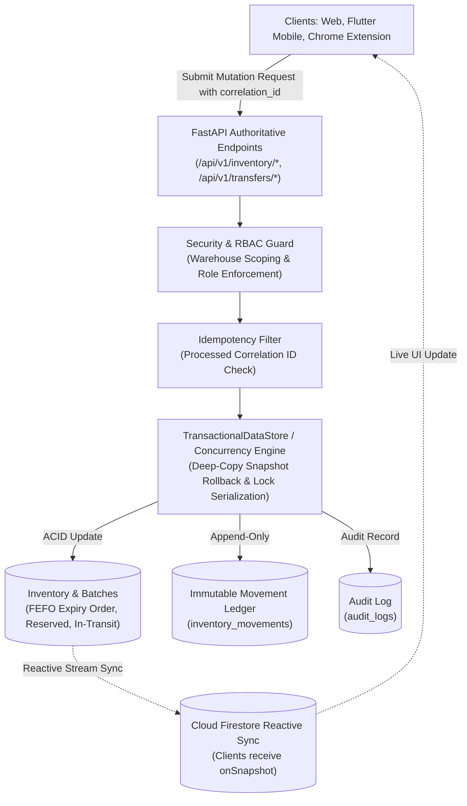
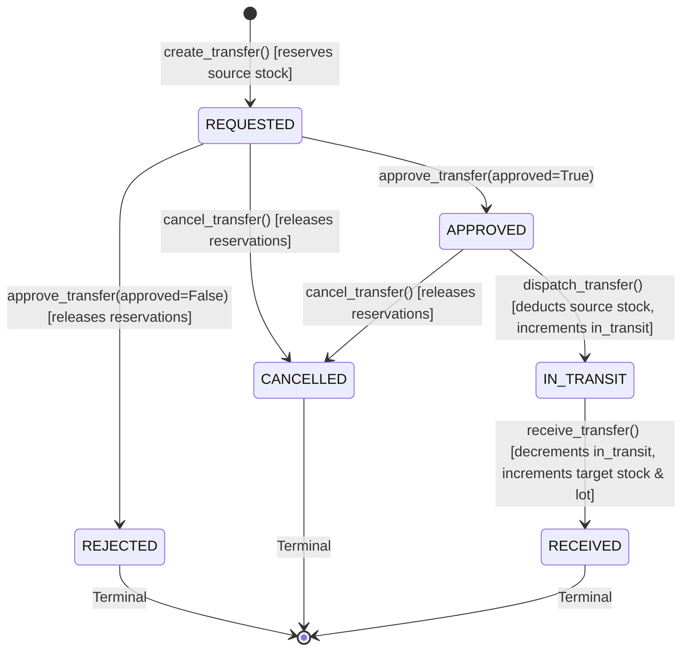

# StockPilot AI — Authoritative Inventory Transaction Engine

## 1. Architectural Overview & Design Principles

The **Authoritative Inventory Transaction Engine** is the single source of truth for all physical stock balance mutations across the StockPilot AI ecosystem (Web platform, Flutter Android companion app, Chrome Extension, and FastAPI backend). 

Direct client mutations to inventory balances or movements in Cloud Firestore are strictly prohibited by Firestore Security Rules. All state changes are submitted to the trusted FastAPI backend, validated inside atomic transactions, and appended to an immutable audit ledger.



---

## 2. Invariants & Guardrails Enforced

| Invariant | Implementation Mechanism | Error Response on Breach |
| :--- | :--- | :--- |
| **Negative Stock Prevention** | Validates `available_quantity >= requested` before deducting. Enforces `inv['available_quantity'] >= 0` and `inv['total_quantity'] >= 0`. | `400 Bad Request: Insufficient available stock` |
| **Idempotency** | Checks `processed_idempotency_keys` for `correlation_id`. | `409 Conflict: Duplicate submission prevented` |
| **Double Dispatch Prevention** | Transfer status check: transfer must be strictly in `approved` state to dispatch. | `409 Conflict: Cannot dispatch transfer in '{status}' state` |
| **Double Approval Prevention** | Transfer status check: transfer must be in `requested` or `pending` state. | `409 Conflict: Double-approval or re-processing forbidden` |
| **Invalid State Transitions** | Evaluates target state against `ALLOWED_TRANSFER_TRANSITIONS`. Terminal states cannot be altered. | `409 Conflict: Invalid state transition` |
| **Warehouse-Level Authorization** | `super_admin`, `org_admin`, and `supply_chain_manager` have global tenant facility access; `warehouse_manager` and `operator` are restricted to their assigned `warehouse_id`. | `403 Forbidden: Unauthorized warehouse operation` |
| **Concurrency & Race Conditions** | Exclusive reentrant lock serialization with isolated deep-copy state snapshotting. Tested with 5 concurrent worker threads. | Atomic rollback to pre-transaction state on error |
| **FEFO Expiration Priority** | Unspecified batch dispatches sort batches by `expiry_date ASC`, consuming earliest expiring batches first. | Automatic allocation across active batches |

---

## 3. Auditable Movement Ledger Schema

Every committed inventory mutation creates an immutable record in `inventory_movements`:

```json
{
  "id": "mov_a1f49b82c30e",
  "org_id": "org_triwiz_01",
  "correlation_id": "DISP-2026-0918-A7",
  "product_id": "prd_vax_01",
  "batch_id": "bat_vax_chi_01",
  "source_warehouse_id": "wh_chicago_01",
  "destination_id": "dest_boston_01",
  "movement_type": "dispatch",
  "quantity_changed": -150,
  "unit": "vials",
  "balance_after": 700,
  "actor_id": "usr_operator",
  "actor_name": "James Operator",
  "actor_role": "operator",
  "reason": "Cold chain fulfillment for Boston Clinic order",
  "timestamp": "2026-10-24T12:43:10.892011+00:00",
  "resulting_status": "COMMITTED"
}
```

---

## 4. Transfer State Machine

Inter-warehouse transfers follow a strict finite state machine:



### Transition Matrix & Stock Balances

| Source State | Target State | Trigger Method | Stock Impact |
| :--- | :--- | :--- | :--- |
| *None* | `REQUESTED` | `POST /api/v1/transfers` | Source `available_quantity -= qty`, `reserved_quantity += qty`. |
| `REQUESTED` | `APPROVED` | `POST /api/v1/transfers/approve` | Confirms reservation; authorizes transit dispatch. |
| `REQUESTED` | `REJECTED` | `POST /api/v1/transfers/approve` | Releases reservation: `reserved_quantity -= qty`, `available_quantity += qty`. |
| `REQUESTED` / `APPROVED` | `CANCELLED` | `POST /api/v1/transfers/cancel` | Releases reservation: `reserved_quantity -= qty`, `available_quantity += qty`. |
| `APPROVED` | `IN_TRANSIT` | `POST /api/v1/transfers/dispatch` | Source `total_quantity -= qty`, `reserved_quantity -= qty`, `in_transit_quantity += qty`. Deducts source batches via FEFO. |
| `IN_TRANSIT` | `RECEIVED` | `POST /api/v1/transfers/receive` | Source `in_transit_quantity -= qty`. Target `total_quantity += qty`, `available_quantity += net_received`, `damaged_quantity += damaged`. Creates/increments batch in target warehouse. |

---

## 5. Supported Authoritative Operations

### 1. Stock Receiving (`POST /api/v1/inventory/receive`)
- Increments or creates the target lot in `inventory_batches`.
- Increments `total_quantity` and `available_quantity` in `inventory`.
- Appends `receipt` entry to ledger.

### 2. Stock Dispatch (`POST /api/v1/inventory/dispatch`)
- Validates available stock.
- Automatically allocates across active batches using FEFO (First-Expired, First-Out) or uses specified batch.
- Decrements batch and warehouse available stock.
- Appends `dispatch` entry to ledger.

### 3. Stock Reservations (`POST /api/v1/inventory/reserve`)
- Holds stock for high-priority purchase orders or emergency allocations.
- Decrements `available_quantity`, increments `reserved_quantity`.
- Prevents double-allocation across competing sales channels.

### 4. Release Reservation (`POST /api/v1/inventory/reserve/release`)
- Releases held units on order timeout or customer cancellation.
- Restores `available_quantity`, decrements `reserved_quantity`.

### 5. Physical Cycle Counting (`POST /api/v1/inventory/cycle-count`)
- Warehouse operators record counted units.
- Calculates variance (`counted_quantity - recorded_quantity`).
- Adjusts batch and warehouse balance by variance.
- Appends `cycle_count` audit entry with variance details.

### 6. Damaged Stock Reporting (`POST /api/v1/inventory/damage`)
- Deducts damaged units from `available_quantity` and increments `damaged_quantity`.
- Associates photo evidence link (scoped to Firebase Storage `/organizations/{orgId}/`).
- Appends `damage_report` entry to ledger.

### 7. Discrepancy Resolution (`POST /api/v1/inventory/discrepancy/resolve`)
- Formal compliance resolution for lost, damaged, found, or expired stock.
- Supports actions: `write_off` (permanent balance reduction), `quarantine` (locks batch from available stock), `restock` (adds found stock).

---

## 6. Concurrency & ACID Rollback Implementation

In [`backend/app/core/database.py`](file:///c:/Users/user/OneDrive/Desktop/Competition/TRIWIZATHON/backend/app/core/database.py):

```python
def run_transaction(self, transaction_fn: Callable[['TransactionalDataStore'], Any]) -> Any:
    """
    Executes a callable inside an exclusive write lock to ensure atomic multi-doc operations.
    Includes complete transactional rollback if an exception is raised during execution.
    """
    import copy
    with self.lock:
        # Isolated deep-copy snapshot of entire datastore
        snapshot = {col: {k: copy.deepcopy(v) for k, v in docs.items()} for col, docs in self._collections.items()}
        try:
            res = transaction_fn(self)
            self.save_to_disk()
            return res
        except Exception as e:
            # Atomic rollback on any failure
            self._collections = snapshot
            self.save_to_disk()
            raise e
```

---

## 7. Verification & Automated Test Results

The engine is verified by comprehensive unit, integration, and stress tests:

### 1. Engine Test Suite (`backend/tests/test_inventory_transaction_engine.py`)
```
platform win32 -- Python 3.14.3, pytest-9.1.1
tests\test_inventory_transaction_engine.py ........... [100%]
======================= 11 passed in 18.83s =======================
```
1. `test_negative_stock_prevention`: **PASSED** — Dispatches exceeding available stock fail with HTTP 400; balance remains non-negative.
2. `test_idempotency_duplicate_requests_prevention`: **PASSED** — Duplicate submission with identical `correlation_id` rejected with HTTP 409 Conflict; no duplicate stock added.
3. `test_stock_reservation_and_release_lifecycle`: **PASSED** — Stock reservation decreases available stock without altering total quantity; release restores availability.
4. `test_cycle_counting_discrepancy_and_ledger`: **PASSED** — Cycle count adjusts batch and inventory by variance (+12 vials) and appends `cycle_count` record.
5. `test_discrepancy_resolution_quarantine_and_write_off`: **PASSED** — Resolves discrepancy by setting batch status to `quarantined` and removing units from available stock.
6. `test_inter_warehouse_transfer_complete_state_machine`: **PASSED** — Full lifecycle `REQUESTED` -> `APPROVED` -> `IN_TRANSIT` -> `RECEIVED`. Double-approval and double-dispatch rejected with HTTP 409. Modifying received transfer rejected with HTTP 409.
7. `test_transfer_cancellation_releases_reserved_stock`: **PASSED** — Cancelling an approved transfer immediately releases 40 reserved units back to available stock.
8. `test_unauthorized_warehouse_operation_rejected`: **PASSED** — Warehouse operator assigned to Chicago facility attempting dispatch at New York facility is rejected with HTTP 403 Forbidden.
9. `test_transactional_rollback_on_failure`: **PASSED** — When an atomic transaction fails midway, all mutated batches are restored to their pre-transaction quantities.
10. `test_concurrent_dispatches_concurrency_control`: **PASSED** — 5 concurrent threads attempting to dispatch 30 units each (150 total) from a 100-unit stock: exactly 3 succeed (90 units deducted), 2 fail (insufficient stock), final balance is exactly 10 units. Zero race condition anomalies.
11. `test_auditable_ledger_schema_completeness`: **PASSED** — Verifies all required fields (`id`, `org_id`, `correlation_id`, `product_id`, `batch_id`, `source_warehouse_id`, `destination_id`, `movement_type`, `quantity_changed`, `unit`, `balance_after`, `actor_id`, `actor_name`, `actor_role`, `reason`, `timestamp`, `resulting_status`).

### 2. Full Regression Test Summary
- `tests/test_inventory_transaction_engine.py`: **11/11 PASSED**
- `tests/test_firebase_architecture.py`: **6/6 PASSED**
- `tests/test_backend.py`: **5/5 PASSED**
- Total Backend Tests: **22/22 PASSED**
- Flutter Mobile Test Suite (`mobile/test/`): **7/7 PASSED**
- Web TypeScript Build (`frontend/`): **2,532 modules built, 0 errors**
