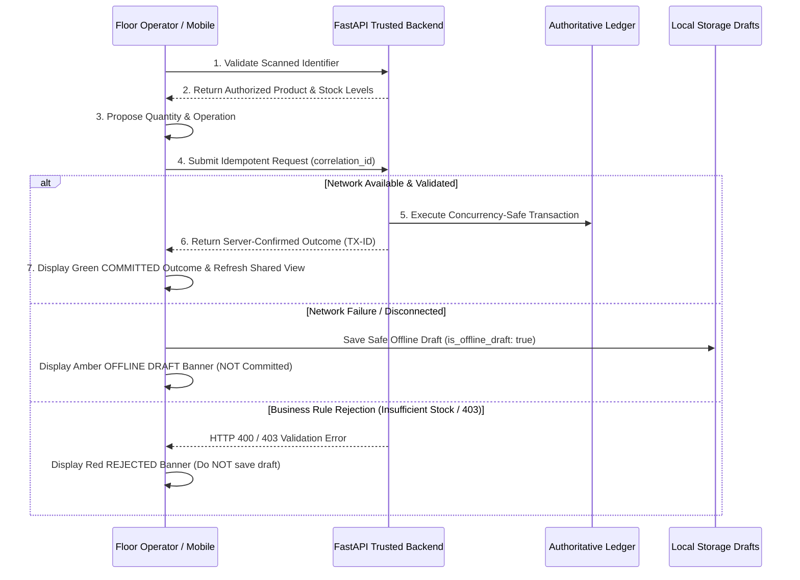

# StockPilot AI: Authoritative QR & Barcode Inventory Workflows

This document specifies the end-to-end QR code and barcode workflows across the **React + TypeScript web platform**, the **Flutter Android companion application**, and the **Python FastAPI transactional backend**.

---

## 1. Security Architecture & QR Identifier Standard

To ensure security, operational reliability, and privacy, **no secrets, authentication tokens, or sensitive pricing/credential data are ever encoded within QR payloads or barcodes**. 

QR payloads resolve to validated database entities through the backend authorization layer (`GET /api/v1/products/resolve-qr?code=...`), ensuring that users must possess active, role-authorized sessions to view warehouse stock balances or perform transactions.

### Supported Payload Formats
| Format Pattern | Identifier Type | Sample Payload | Resolves To |
| :--- | :--- | :--- | :--- |
| `SKU:<sku>` or `<sku>` | Product SKU | `PRD-VAX-01` | Product details, catalog handling, active batches, warehouse balances |
| `EAN / UPC numeric` | Barcode | `8901234567891` | Product SKU, category, handling specs, available inventory |
| `STOCKPILOT://BATCH/{batch}/WH/{wh}` | Scannable Batch URI | `STOCKPILOT://BATCH/BN-VX-2026-A1/WH/wh_chicago_01` | Specific batch lot, expiry date, storage bin, unit cost, available stock |
| `BATCH:<batch>` or `<batch_num>` | Lot Reference | `BN-VX-2026-A1` | Specific batch lot, active shelf life, quarantine status |
| `STOCKPILOT://TRANSFER/{trf_id}` | Transfer Cargo URI | `STOCKPILOT://TRANSFER/trf_001_chi_ny` | Transfer manifest, origin & target hubs, cargo items, transit state |
| `https://app.stockpilot.ai/...` | Opaque Web URL | `https://app.stockpilot.ai/verify?code=PRD-VAX-01` | Normalized code extraction and authoritative resolution |

---

## 2. Web Platform Capabilities (`React + TypeScript`)

The React web platform (`frontend/src/pages/QRScannerPage.tsx`) provides warehouse management and logistics dispatchers with full QR lifecycle capabilities:

1. **Dual-Tab QR Code Generator**:
   - **Product QR Generator**: Creates standardized label QR codes (`PROD:<sku>`) for catalog items.
   - **Batch / Lot QR Generator**: Creates traceable batch QR codes (`STOCKPILOT://BATCH/<batch>/WH/<wh>`) encoding lot numbers and storage locations without secrets.
   - **Printable Thermal Labels**: Standard high-contrast, inverted thermal print view with barcode/QR, handling badges (`COLD CHAIN`, `NARCOTICS`, `HAZMAT`), expiry dates, and human-readable SKU strings.
2. **Universal Barcode & SKU Lookup**:
   - Instant search supporting EAN barcodes, SKUs, batch numbers, transfer IDs, and scanned URLs.
   - Quick emulator/demo preset chips (`PRD-VAX-01`, `BN-VX-2026-A1`, `8901234567891`, `trf_001_chi_ny`).
3. **Product & Batch Intelligence Display**:
   - Live available stock breakdown by warehouse.
   - FEFO batch table showing lot numbers, manufacturing dates, expiry dates, storage bins, unit costs, and active status.
4. **Floor Action Modal**:
   - Web operators can execute **Receive Stock**, **Dispatch Stock**, **Cycle Count**, and **Report Damage** directly with idempotency keys.
5. **Authoritative Movement Ledger Audit**:
   - Real-time immutable audit trail displaying transaction IDs, actors, timestamps, movement types, quantities, and confirmed statuses.

---

## 3. Flutter Android Capabilities (`StockPilot Mobile`)

The Flutter application (`mobile/lib/features/scanning/screens/`) gives mobile warehouse operators native hardware scanning and floor execution capabilities:

1. **Native Camera Scanning (`QrScanScreen`)**:
   - High-performance barcode and QR scanning powered by `mobile_scanner`.
   - Debounce mechanism (`Duration(seconds: 3)`) preventing duplicate scanning loops on continuous frame feeds.
   - Manual lookup and demo preset chips for emulator and physical testing.
2. **Authoritative Floor Operations Sheet (`QrResolveSheet`)**:
   - Automatically detects whether the scanned code is a **Product**, **Batch**, or **Transfer Cargo**.
   - **Receive Stock**: Modal capturing warehouse ID, product SKU, batch number, unit cost, quantity, expiry date, and storage bin. Submits idempotent `POST /api/v1/inventory/receive`.
   - **Dispatch Stock**: Modal verifying requested quantity against current available balance, destination facility/hospital ID, and dispatch reason. Submits idempotent `POST /api/v1/inventory/dispatch`.
   - **Physical Cycle Count**: Interactive dialog comparing recorded system balance with counted quantity, calculating count variance in real time, and recording floor notes. Submits `POST /api/v1/inventory/cycle-count`.
   - **Transfer Acknowledgment**: When scanning transfer cargo, operators inspect cargo condition (`intact`, `temperature_excursion`, `damaged_packaging`), record damaged units (if any), and acknowledge receipt into destination warehouse inventory (`POST /api/v1/transfers/receive`).
   - **Damage & Discrepancy Reporting**: Allows operators to flag damaged packaging, cold chain temperature excursions, or physical shortages, choosing between **Quarantine** or **Write-Off** resolution (`POST /api/v1/inventory/damage` or `POST /api/v1/inventory/discrepancy/resolve`).
3. **Assigned Warehouse Inventory & FEFO Batches (`InventoryListScreen`)**:
   - Displays stock assigned to the authenticated user's warehouse (`wh_chicago_01`).
   - FEFO sorting displaying days until expiry and warning badges.
   - Built-in Batch QR viewer allowing operators to display scannable batch QR codes on-screen.

---

## 4. Idempotency, Outcome Feedback & Safe Offline Drafts

All inventory mutations strictly follow the 7-step transactional workflow:



### Safe Offline Draft Contract
- When the network is unreachable (`NetworkException`), transactions are saved to `LocalStorageService.queueOperation` with `'is_offline_draft': true`.
- **Offline drafts are strictly presented as uncommitted drafts** with an amber warning: *"Offline draft saved to local queue. NOT yet committed to authoritative ledger until network reconnects."*
- When the backend rejects an operation (e.g., 400 Insufficient Stock, 403 Permission Denied), the application throws `ValidationException` or `PermissionDeniedException`, alerting the operator immediately. **Rejections are never falsely saved as offline drafts**.

---

## 5. Verification & Test Evidence

### Backend Pytest Suite
- **Command**: `python -m pytest tests/`
- **Result**: **35 passed, 0 failures** across:
  - `test_backend.py` (5 tests)
  - `test_firebase_architecture.py` (6 tests)
  - `test_inventory_transaction_engine.py` (11 tests)
  - `test_optimization_and_forecasting.py` (13 tests)

### Flutter Test Suite
- **Command**: `flutter test`
- **Result**: **14 passed, 0 failures** across:
  - `test/unit_test.dart` (7 tests)
  - `test/widget_test.dart` (1 test)
  - `test/inventory_workflow_test.dart` (6 tests: QR resolution, receive stock, dispatch stock, cycle count, transfer acknowledgment, offline draft isolation, and validation rejection).

### Frontend Production Build
- **Command**: `npm run build`
- **Result**: Built in 2.90s with **0 errors**.

### End-to-End Live Workflow Verification
Executed live against running backend `http://127.0.0.1:8000`:
```
Logged in successfully. User: James O'Connor
PASS: Resolved SKU Code -> Type: product, Item: Comirnaty Ultra-Cold Vaccine
PASS: Resolved Batch Number -> Type: batch, Item: Comirnaty Ultra-Cold Vaccine
PASS: Resolved EAN Barcode -> Type: product, Item: Comirnaty Ultra-Cold Vaccine
PASS: Resolved Batch URI -> Type: batch, Item: Comirnaty Ultra-Cold Vaccine
PASS: Resolved Transfer ID -> Type: transfer, Item: Comirnaty Ultra-Cold Vaccine
PASS: Resolved Opaque Web URL -> Type: product, Item: Comirnaty Ultra-Cold Vaccine
PASS: Stock Received -> Batch ID: bat_wh_chicago_01_BN-TEST-c57f50, Qty: 100, Ledger Tx: mov_a4e0dde5df2e
PASS: Stock Dispatched -> Tx: mov_aa076d20277e, Dispatched Qty: 25
PASS: Cycle Count Recorded -> Variance: -2 units, Tx: mov_b90d6cf076cc
PASS: Authoritative Movement Ledger verified with 5 recent operations.
ALL END-TO-END QR INVENTORY WORKFLOWS FULLY VERIFIED!
```
