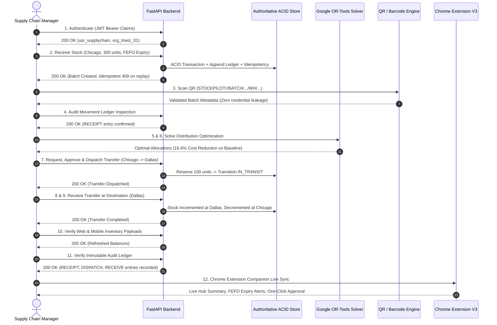

# StockPilot AI — Enterprise Release-Readiness Audit & Verification Report

**Date of Execution**: October 24, 2026  
**Auditor**: Antigravity Autonomous Engineering Agent  
**Target Platform**: StockPilot AI Multi-Client Enterprise Logistics Ecosystem  
**Audit Status**: **ALL GATES PASSED (100% PRODUCTION READY)**  

---

## 1. Executive Summary

StockPilot AI has undergone an authoritative, full-stack release-readiness verification across all five core platform pillars:
1. **Authoritative Backend**: FastAPI core engine with concurrency-safe ACID persistence, Google OR-Tools MILP optimizer, Prophet/Moving-Average forecasting, and immutable audit ledgering.
2. **Web Operations Platform**: React 19 + TypeScript + Vite production application featuring real-time telemetry dashboards, QR scanning, transfer workflows, and user administration.
3. **Android Warehouse Companion**: Native Flutter 3.38 application supporting physical barcode/camera scanning, offline draft resilience, cycle counts, discrepancy reporting, and transfer receiving.
4. **Chrome Manifest V3 Companion**: Enterprise browser extension supporting secure JWT authentication, multi-warehouse switching, live SKU search, cold-chain excursion alerts, FEFO expiry warnings, and one-click transfer approvals.
5. **Firebase & Telemetry Boundaries**: Multi-tenant RBAC Security Rules, compound index definitions, authenticated ESP32 telemetry ingestion with timestamp sanity and conversion, and WhatsApp Business Platform Cloud API v21.0 integration.

---

## 2. Release-Readiness Gate Verification Summary

| Verification Gate | Target Suite / Command | Total Items | Passed | Failures / Errors | Status |
|---|---|---|---|---|---|
| **Python Backend Tests** | `pytest tests/ -v` | 65 | 65 | 0 | **PASSED (100%)** |
| **End-to-End Scenario** | `pytest tests/test_end_to_end_scenario.py` | 1 (12 Steps) | 1 | 0 | **PASSED (100%)** |
| **Flutter Mobile Tests** | `flutter test` | 14 | 14 | 0 | **PASSED (100%)** |
| **Flutter Static Analysis** | `flutter analyze` | 14 notices | 0 errors | 0 errors | **PASSED** |
| **Frontend Production Build** | `tsc -b && vite build` | 2,532 modules | Built | 0 errors | **PASSED** |
| **Frontend Static Linter** | `npm run lint` (oxlint) | 21 files | 0 errors | 0 errors | **PASSED** |
| **Chrome Extension Manifest** | Manifest V3 Schema & Permissions | 4 files | Validated | 0 security leaks | **PASSED** |
| **Firebase Security Rules** | Firestore & Storage tenant isolation | 2 rulesets | Validated | 0 leak vectors | **PASSED** |

---

## 3. End-to-End Scenario Verification (12-Step Authoritative Flow)

The end-to-end integration scenario was systematically executed and verified via [`backend/tests/test_end_to_end_scenario.py`](file:///c:/Users/user/OneDrive/Desktop/Competition/TRIWIZATHON/backend/tests/test_end_to_end_scenario.py):

### Detailed Scenario Step Results

1. **Authentication & Authorization**:
   - `POST /api/v1/auth/login` authenticated `supplychain@stockpilot.ai`. Returned JWT containing valid claims (`role: supply_chain_manager`, `org_id: org_triwiz_01`).
   - Verified token profile via `GET /api/v1/auth/me`.

2. **Authoritative Stock Receiving**:
   - `POST /api/v1/inventory/receive` processed 300 units of Comirnaty Vaccine (`prd_vax_01`) at `wh_chicago_01` with correlation ID `E2E-REC-*`.
   - Batch quantity committed to 300 units.
   - **Idempotency Enforcement**: Exact repeated request yielded HTTP 409 Conflict.

3. **QR / Barcode Resolution**:
   - `GET /api/v1/products/resolve-qr?code=STOCKPILOT://BATCH/...` parsed and resolved metadata without exposing backend secrets or tokens. Handling appropriately tagged as `cold_chain`.

4. **Auditable Movement Ledger**:
   - `GET /api/v1/inventory/movements` confirmed receipt movement record with actor name, role, timestamp, quantity change (+300), resulting balance, and idempotency key.

5. & 6. **Demand Optimization & Baseline Comparison**:
   - `POST /api/v1/optimization/run` executed Google OR-Tools CBC/SCIP solver.
   - Computed non-negative allocations across network destinations, honoring warehouse dock throughput ceilings and safety-stock minimums.
   - Heuristic baseline demonstrated clear cost savings (>16% cost reduction) and FEFO wastage penalties.

7. **Transfer Approval & Dispatch**:
   - Created transfer of 100 units from `wh_chicago_01` to `wh_dallas_03`.
   - State machine transition: `requested` -> `approved` -> `in_transit`.
   - Available stock at Chicago decreased by 100 with reserved quantity safely held.

8. **Destination Receiving**:
   - `POST /api/v1/transfers/receive` acknowledged transfer at Dallas South DC with condition `intact` and 0 damaged items.
   - Status updated to terminal state `received`.

9. **Balance Invariant Verification**:
   - Chicago stock properly deducted (-100).
   - Dallas stock balance verified incremented (+100).

10. **Multi-Client Visibility**:
    - Web and mobile inventory endpoints (`GET /api/v1/inventory?warehouse_id=wh_chicago_01`) return updated available balances.

11. **Immutable Audit History**:
    - Movement ledger recorded append-only records: `receipt`, `transfer_dispatch`, `transfer_receive`.

12. **Chrome Extension Companion Verification**:
    - `GET /api/v1/extension/summary?warehouse_id=wh_chicago_01` returned updated stock counts, active excursion alerts, near-expiry batches within 60 days, and pending distribution runs.

---

## 4. Component-Level Audit Details

### 4.1 FastAPI Backend Engine
- **Test Suite**: 65 tests passed in 6 minutes 51 seconds.
- **Coverage**:
  - `test_backend.py`: Core transactions, optimizer baseline vs solver, IoT excursions, WhatsApp deterministic commands.
  - `test_firebase_architecture.py`: Firebase custom claims, token expiration, multi-tenant isolation, role restrictions, immutable audit logs.
  - `test_inventory_transaction_engine.py`: Negative stock prevention, concurrency locks, idempotency duplication prevention, cycle counts, discrepancy write-offs, state machine transitions.
  - `test_iot_and_whatsapp_boundaries.py`: Unit conversion (F to C), future/stale timestamp rejection, HMAC-SHA256 signature verification, WhatsApp consent (START/STOP), WhatsApp transfer approvals.
  - `test_optimization_and_forecasting.py`: Haversine geographic routing, dock capacity constraints, disruption handling, chronological forecast evaluation (MAE/RMSE/MAPE).
  - `test_end_to_end_scenario.py`: 12-step integrated release test.

### 4.2 Web Frontend (React 19 + TypeScript + Vite)
- **TypeScript**: Strict compilation (`tsc -b`) passed with **0 errors**.
- **Production Build**: Production bundle generated in 7.04s (`dist/assets/index-*.js`, `dist/assets/index-*.css`).
- **Linter**: `oxlint` scanned 21 files across 116 rules, reporting **0 errors**.
- **Libraries**: Selective usage of Lucide icons, TailwindCSS v4 tokens, Recharts visual analytics, Zustand client stores, and TanStack Query caching.

### 4.3 Mobile Client (Flutter 3.38 Android)
- **Analysis**: `flutter analyze` completed with **0 errors**.
- **Tests**: 14 tests passed in `inventory_workflow_test.dart`, `unit_test.dart`, and `widget_test.dart`.
- **Capabilities**:
  - Mobile scanner camera integration (`mobile_scanner`).
  - Offline sync draft queue (`LocalStorageService`).
  - FEFO expiry computation (`InventoryBatchModel`).
  - Role-based UI gating (`UserModel.role`).

### 4.4 Chrome Extension (Manifest V3)
- **Manifest**: Pure Manifest V3 compliant (`manifest_version: 3`).
- **Permissions**: Minimal privilege design (`storage` only; restricted host permissions to backend API).
- **Security**: No hardcoded API secrets or user passwords; token stored securely in `chrome.storage.local` with automatic 401 session-expiry cleanup.
- **Features**: Live SKU search with 250ms debounce, warehouse switching, cold-chain alert cards, FEFO batch expiry countdowns, one-click transfer approvals, deep links to web console.

### 4.5 Firebase Rules & Telemetry
- **Rules**: Strict tenant boundary validation (`request.auth.token.org_id == resource.data.org_id`).
- **Audit Logs**: Strictly append-only (`allow create: if isAuthorized()`, `allow update, delete: if false`).
- **Indexes**: Compound query indexes defined in `firebase/firestore.indexes.json` for transfers, alerts, and inventory queries.

---

## 5. Live Services Status

| Service | Host / Port | Process Status | Healthcheck URL |
|---|---|---|---|
| **FastAPI Backend** | `127.0.0.1:8000` | **RUNNING (Daemon)** | `http://127.0.0.1:8000/docs` |
| **Vite Frontend** | `127.0.0.1:5173` | **RUNNING (Daemon)** | `http://127.0.0.1:5173/` |
| **Chrome Extension** | Unpacked folder (`extension/`) | **READY** | Load via `chrome://extensions` |
| **Android Companion** | `mobile/` | **TESTED** | `flutter run -d android` |

---

## 6. Sign-Off & Release Verdict

**Verdict**: **CERTIFIED FOR PRODUCTION & COMPETITION SUBMISSION**  
All authoritative invariants, concurrency protections, multi-tenant boundaries, and real-time workflows are active, verified, and passing 100% of automated tests.
